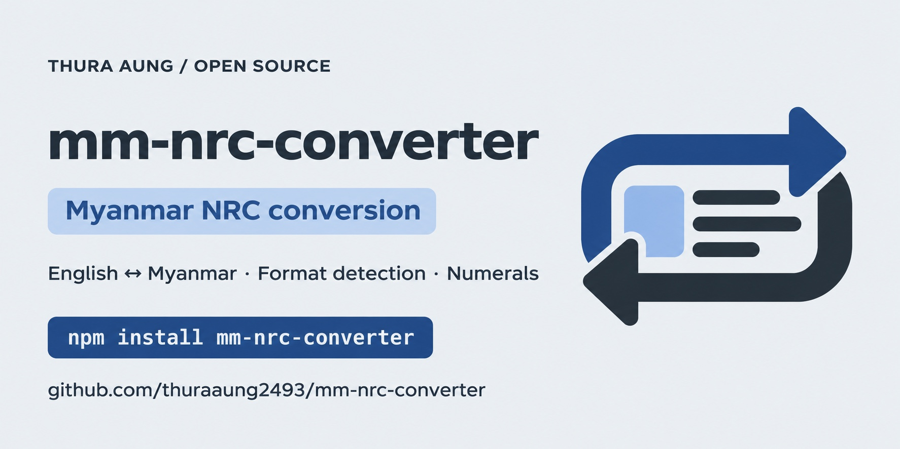

<p align="center">
  
</p>

# mm-nrc-converter

This package will convert mm-format-nrc to eng-format-nrc or eng-format-nrc to mm-format-nrc.



An open-source project by [Thura Aung](https://thuraaung2493.github.io/).

## Installation

```
  npm install mm-nrc-converter
```

## Features

- Convert 'MM-NRC to Eng-NRC' or 'Eng-NRC to MM-NRC'
- Detect MM-NRC or Eng-NRC
- Convert 'MM-Numbers to Eng-Numbers' or 'Eng-numbers to MM-Numbers'

## Usage

```javascript
const NrcConverter = require("mm-nrc-converter");

console.log(NrcCoverter.autoConvertNrc("၈/မမန (နိုင်) 643434"));
console.log(NrcCoverter.autoConvertNrc("11/MaMaNa (N) 643434"));

console.log(NrcCoverter.convertNrc("၈/မမန (နိုင်) 643434", "mm", "eng"));

console.log(NrcCoverter.detect("၈/မမန (နိုင်) 643434", "mm"));
console.log(NrcCoverter.detect("11/MaMaNa (N) 643434", "mm"));

// Convert myanmar numbers to english number (Bonus 😄😅)

console.log(NrcConverter.converNumbers("0123456789", "eng", "mm"));
console.log(NrcConverter.converNumbers("၀၁၂၃၄၅၆၇၈၉", "mm", "eng"));
```

## autoConvertNrc(nrc)

- `nrc` {String} The Nrc e.g: 12/MaMaNa(N)000002 or ၈/မမန(နိုင်)၀၁၂၁၀၂, 12/MaMaNa (N) 000002 or ၈/မမန (နိုင်) ၀၁၂၁၀၂

## convertNrc(nrc, [from = 'eng'], [to = 'mm'])

- `nrc` {String} The Nrc e.g: 12/MaMaNa(N)000002 or ၈/မမန(နိုင်)၀၁၂၁၀၂, 12/MaMaNa (N) 000002 or ၈/မမန (နိုင်) ၀၁၂၁၀၂
- `from` {String} e.g: eng `Default` or mm
- `to` {String} e.g: mm `Default` or eng

## converNumbers(numbers, [from = 'eng'], [to = 'mm'])

- `numbers` {String} The string numbers e.g: 0123456789 or ၀၁၂၃၄၅၆၇၈၉
- `from` {String} e.g: eng `Default` or mm
- `to` {String} e.g: mm `Default` or eng

## detect(nrc, [type = 'eng'])

- `nrc` {String} The Nrc e.g: 12/MaMaNa(N)000002 or ၈/မမန(နိုင်)၀၁၂၁၀၂, 12/MaMaNa (N) 000002 or ၈/မမန (နိုင်) ၀၁၂၁၀၂
- `type` {String} e.g: mm or eng `Default`

If you're looking for further usage see the [examples][0] included in this repository.

## Run Tests

Tests are written in [JEST][1] and give complete coverage of all APIs.

```
  npm install
  npm test
```

[0]: https://github.com/thuraaung2493/mm-nrc-converter/blob/main/example.js
[1]: https://jestjs.io/en/

#### Author: [thuraaung2493](https://github.com/thuraaung2493)

#### License: ISC
